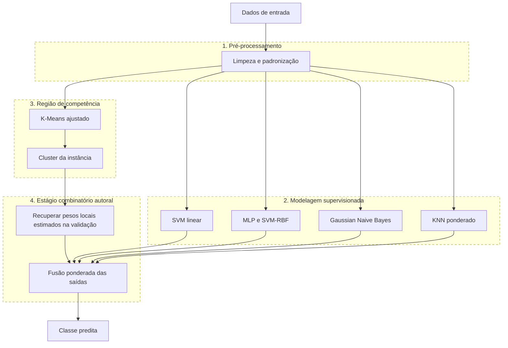

# Sistema híbrido de classificação por competência local

## 1. Objetivo

Desenvolver em Python um sistema híbrido que combine classificadores supervisionados com diferentes características de aprendizagem. O K-Means identifica regiões do espaço de atributos, e o desempenho dos classificadores em cada região determina sua contribuição para a decisão final.

Investigar se a ponderação local melhora o desempenho em relação aos classificadores individuais e à ponderação global. Não presumir que o híbrido será superior: verificar a hipótese experimentalmente.

O agente deve implementar o projeto completo, obter as bases, executar os experimentos, analisar os resultados e preparar um diagrama da arquitetura. Não é necessário elaborar relatório formal.

## 2. Bases de dados

Utilizar as dez bases públicas de classificação binária abaixo, disponíveis no UCI. A aquisição pode ser feita com `ucimlrepo`. Conferir atributos, alvo, dimensões e significado das classes na fonte antes de utilizar cada base.

| Base | ID UCI | Amostras | Atributos |
|---|---:|---:|---:|
| Sonar | [151](https://archive.ics.uci.edu/dataset/151) | 208 | 60 |
| Ionosphere | [52](https://archive.ics.uci.edu/dataset/52) | 351 | 34 |
| Banknote Authentication | [267](https://archive.ics.uci.edu/dataset/267) | 1372 | 4 |
| Blood Transfusion | [176](https://archive.ics.uci.edu/dataset/176) | 748 | 4 |
| Climate Model Simulation Crashes | [252](https://archive.ics.uci.edu/dataset/252) | 540 | 18 |
| QSAR Biodegradation | [254](https://archive.ics.uci.edu/dataset/254) | 1055 | 41 |
| Raisin | [850](https://archive.ics.uci.edu/dataset/850) | 900 | 7 |
| Rice (Cammeo and Osmancik) | [545](https://archive.ics.uci.edu/dataset/545) | 3810 | 7 |
| Spambase | [94](https://archive.ics.uci.edu/dataset/94) | 4601 | 57 |
| Diabetic Retinopathy Debrecen | [329](https://archive.ics.uci.edu/dataset/329) | 1151 | 19 |

As dimensões são referências anteriores ao pré-processamento. Registrar os valores efetivamente encontrados. Excluir identificadores (inclusive os de simulação na Climate), verificar se registros relacionados ou duplicados exigem permanecer na mesma partição e documentar qualquer tratamento. Não substituir bases sem informar.

## 3. Pré-processamento

- Separar atributos `X` e alvo `y`; codificar as classes como 0 e 1 e documentar seu significado.
- Investigar valores ausentes, inconsistentes, duplicados, atributos constantes e desbalanceamento.
- Imputar atributos numéricos ausentes pela mediana quando necessário; remover atributos constantes e identificadores.
- Padronizar atributos com `StandardScaler`: `z = (x - média) / desvio_padrão`.
- Usar PCA para visualizar os agrupamentos em duas dimensões, sem substituir os atributos do experimento principal. Não interpretar a projeção como a geometria completa dos dados.

Ajustar as transformações exclusivamente nos dados de treinamento de cada divisão. Não balancear ou transformar o conjunto de teste a partir de suas próprias estatísticas.

## 4. Classificadores

Comparar cinco classificadores individuais e duas estratégias híbridas. Os hiperparâmetros abaixo são valores iniciais fixados para manter o experimento simples e reproduzível, não resultados de otimização.

| ID | Modelo | Configuração inicial |
|---|---|---|
| M1 | SVM linear | `SVC(kernel="linear", C=1, probability=True)` |
| M2 | SVM-RBF | `SVC(kernel="rbf", C=1, gamma="scale", probability=True)` |
| M3 | MLP | Uma camada oculta de 32 neurônios, tanh, SGD, backpropagation, momentum=0.9, learning_rate_init=0.01, alpha=0.0001, max_iter=1000 |
| M4 | Gaussian Naive Bayes | `GaussianNB()` |
| M5 | KNN | `KNeighborsClassifier(n_neighbors=5, weights="distance", metric="euclidean")` |
| M6 | Híbrido global | Ponderação pelo desempenho global dos cinco classificadores |
| M7 | Híbrido local | Ponderação pelo desempenho dos cinco classificadores em cada cluster |

A SVM linear explora fronteiras lineares e margem máxima; a SVM-RBF e a MLP, relações não lineares; o Naive Bayes, probabilidades a posteriori (MAP); e o KNN, similaridade entre instâncias. A regularização e os parâmetros dos modelos controlam a complexidade e ajudam a discutir generalização e viés-variância.

Utilizar as implementações individuais do scikit-learn. A lógica de agrupamento, estimação de competência, cálculo de pesos e fusão deve ser coordenada por código próprio. Não utilizar `VotingClassifier`, `StackingClassifier` ou outros combinadores prontos. Usar as mesmas saídas dos cinco modelos para construir M6 e M7.

## 5. Sistema híbrido autoral

### 5.1. Regiões de competência

Ajustar o K-Means sobre os atributos de treinamento padronizados, sem utilizar os rótulos. Utilizar inicialmente três clusters (`n_clusters=3`, `n_init=20`, `random_state=42`). Associar cada instância ao centroide mais próximo pela distância euclidiana.

Analisar os tamanhos dos grupos e a dispersão intracluster (within) e intercluster (between). Usar esses valores para descrever a estrutura dos agrupamentos, sem introduzir outro índice de seleção de clusters. Os clusters não são necessariamente equivalentes às classes.

### 5.2. Estimação de competência

Obter predições de validação interna dos cinco classificadores (seção 6). Não utilizar acertos sobre os próprios exemplos usados no ajuste do classificador para estimar a competência.

Para cada modelo `m`, calcular a acurácia global e a acurácia dentro de cada cluster `c`:

```text
competencia_global[m] = acertos_do_modelo / total_de_amostras_de_validacao
competencia_local[m,c] = acertos_do_modelo_no_cluster / total_de_amostras_no_cluster
```

### 5.3. Ponderação por desempenho

M6 utiliza pesos fixos, proporcionais à competência global. M7 utiliza pesos proporcionais à competência no cluster da instância consultada:

```text
peso_global[m] = competencia_global[m] / soma(competencias_globais)
peso_local[m,c] = competencia_local[m,c] / soma(competencias_locais_no_cluster_c)
```

Normalizar os pesos de modo que somem 1. Se a competência local não puder ser estimada (cluster sem exemplos de validação ou soma zero), utilizar os pesos globais. Se a soma global for zero, usar pesos iguais (1/5). Não introduzir suavização, expoentes ou outras estratégias de ponderação.

### 5.4. Fusão e decisão

Cada classificador retorna um vetor de estimativas de probabilidade para as classes 0 e 1. Para cada classe `j`, calcular:

```text
score[j] = soma(peso[m] * probabilidade[m,j] para m em 1..5)
classe_predita = argmax(score)
```

M6 usa `peso_global`; M7 identifica o cluster de cada nova amostra e recupera `peso_local` correspondente. A diferença entre eles deve ser somente a forma de calcular os pesos.

Alinhar as colunas de `predict_proba` pela ordem das classes. Usar `argmax` das mesmas probabilidades para as predições dos classificadores individuais e para estimar as competências. Resolver empates de maneira determinística. As saídas são estimativas; não afirmar que as probabilidades são perfeitamente calibradas.

## 6. Protocolo experimental

Executar um único experimento: validação cruzada estratificada de 5 folds externos, com 3 folds internos para obter as predições de validação usadas na estimação das competências. Usar `random_state=42` e as mesmas divisões para todos os modelos. Se houver grupos de observações dependentes, mantê-los na mesma partição e documentar a divisão.

Para cada base e cada fold externo:

1. Separar treinamento e teste externos. Reservar o teste exclusivamente para a avaliação final.
2. Dividir o treinamento externo em três folds internos. Para cada um, ajustar o pré-processamento e os cinco classificadores apenas nos dois folds internos de treinamento, predizendo o fold interno restante. Reunir as predições de validação, de forma que cada exemplo do treinamento externo tenha uma predição de cada modelo que não o utilizou no ajuste.
3. Ajustar o pré-processamento do roteador e o K-Means sobre todo o treinamento externo, sem rótulos. Associar os exemplos desse treinamento aos clusters desse mesmo K-Means e calcular as competências global e local com as predições de validação interna e seus rótulos.
4. Treinar novamente os cinco classificadores, com seus respectivos pré-processadores, sobre todo o treinamento externo. Manter os hiperparâmetros fixados na seção 4.
5. Predizer o teste externo com os cinco modelos e os dois híbridos. Aplicar o roteador já ajustado para identificar os clusters das instâncias de teste. Não recalcular competências ou pesos no teste.
6. Calcular e salvar as métricas dos sete modelos.

Repetir para os cinco folds e as dez bases. O protocolo produz 350 registros (10 bases × 7 modelos × 5 folds), cada um com as métricas correspondentes. Esses registros serão agregados em 70 resultados médios, um por par base/modelo.

## 7. Métricas e análise estatística

Calcular a partir dos resultados de teste:

- Acurácia: `(VP + VN) / N`.
- Precisão: `VP / (VP + FP)`.
- Sensibilidade: `VP / (VP + FN)`.
- Especificidade: `VN / (VN + FP)`.
- ROC-AUC: área sob a curva ROC, utilizando o score contínuo da classe positiva, não apenas a classe predita.
- Matriz de confusão: VP, VN, FP e FN.

Registrar média e desvio-padrão de cada métrica por base e modelo. Identificar métricas indefinidas e sua causa. Utilizar ROC-AUC como métrica principal da comparação estatística, definida antes da execução, considerando que algumas bases são desbalanceadas. Analisar também acurácia, sensibilidade e especificidade para verificar o desempenho nas duas classes.

### Friedman-Nemenyi

1. Construir uma matriz de 10 linhas (bases) e 7 colunas (modelos) com a ROC-AUC média dos cinco folds externos.
2. Aplicar o teste de Friedman com nível de significância de 5%, considerando as bases como blocos. H0: não há diferença sistemática entre os rankings dos modelos; H1: existe diferença.
3. Calcular o ranking médio: rank 1 para o melhor resultado de cada base, utilizando ranks médios nos empates.
4. Se Friedman rejeitar H0, executar o pós-teste de Nemenyi e apresentar os p-valores entre pares de modelos. A diferença crítica é `CD = q_alpha * sqrt(A*(A+1)/(6*N))`, com `A=7` algoritmos e `N=10` bases; utilizar a convenção apropriada de Nemenyi para `q_alpha`.
5. Interpretar se o híbrido local melhora em relação ao global e aos individuais. Se o teste não for significativo, não concluir que os modelos são equivalentes ou que há superioridade comprovada.

Usar SciPy e scikit-posthocs. Não tratar os folds como bases independentes. Não executar o teste final com resultados incompletos nem inventar resultados.

## 8. Organização e implementação

Estrutura simples sugerida (adaptar se o repositório já possuir código):

```text
project/
├── AGENTS.md
├── README.md
├── requirements.txt
├── main.py
├── data/
├── src/
│   ├── datasets.py
│   ├── preprocessing.py
│   ├── models.py
│   ├── hybrid.py
│   ├── evaluation.py
│   └── statistical_tests.py
├── tests/
└── results/
```

Bibliotecas: NumPy, pandas, scikit-learn, SciPy, scikit-posthocs, matplotlib e ucimlrepo. Utilizar CPU, sem serviços ou frameworks adicionais. Centralizar os parâmetros e evitar duplicação de código.

Implementar na ordem: (1) aquisição e inspeção das bases; (2) pré-processamento e classificadores; (3) agrupamento e competências; (4) fusões global e local; (5) avaliação cruzada; (6) testes estatísticos; (7) apresentação dos resultados.

Validar o código antes de executar as dez bases: pesos não negativos e soma igual a 1; alinhamento das probabilidades; predições consistentes; separação entre treino e teste; cobertura da validação interna; igualdade entre os dois híbridos quando existe apenas uma região ou todos os pesos locais coincidem com os globais. Não criar perfis experimentais separados.

## 9. Entregáveis

- Código funcional e instruções curtas de instalação e execução no README.md.
- Tabela com características das dez bases e tratamentos realizados.
- CSV com métricas por fold e tabela consolidada de médias e desvios-padrão.
- Pesos globais e locais, tamanhos dos clusters e análise dos agrupamentos.
- Resultados de Friedman, rankings médios e Nemenyi quando aplicável.
- Diagrama da arquitetura em Mermaid ou UML, com etapas delimitadas por linhas pontilhadas. Não utilizar ferramentas de geração de imagens.
- Apresentação breve com arquitetura, funcionamento do mecanismo autoral, comparação experimental e conclusões.

Diagrama de referência da inferência (a estimação de competência ocorre durante o treinamento, conforme a seção 6):



Executar as etapas até obter resultados reais. Manter o escopo definido neste documento; não acrescentar algoritmos, métricas ou experimentos não solicitados. Se houver impedimentos, registrar o que falhou e entregar o que foi efetivamente concluído.
