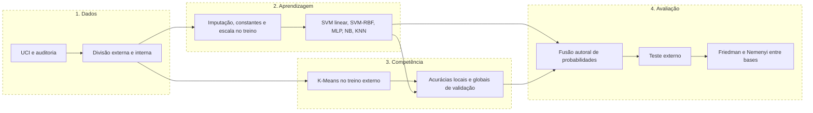
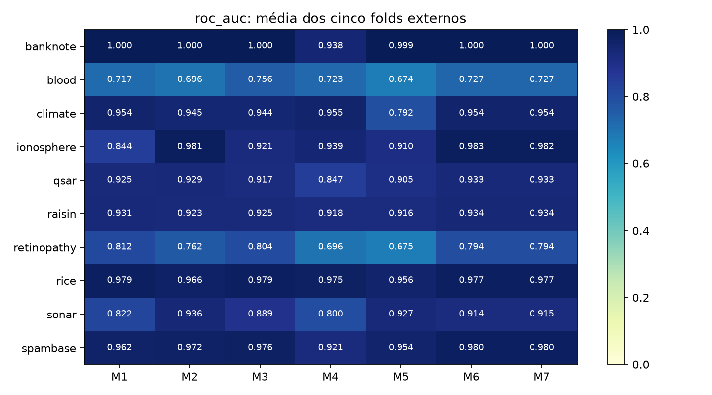
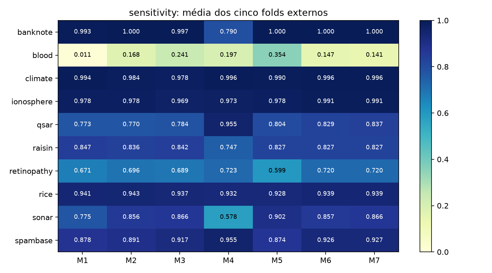
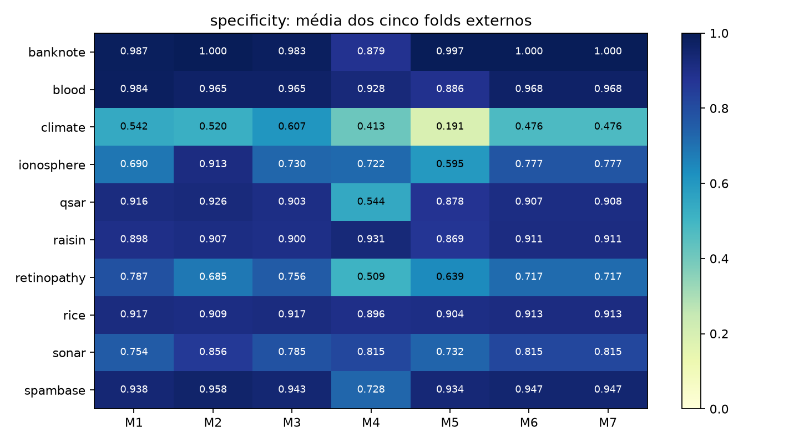
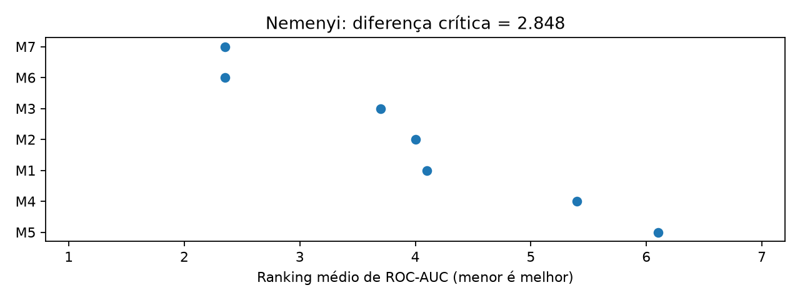

# Classificação híbrida por competência local

## 1. Pergunta e desenho

A contribuição dos modelos muda entre regiões dos atributos? Comparar cinco classificadores individuais, a combinação global M6 e a combinação local M7 em dez bases UCI. Hipótese investigada, sem assumir superioridade do híbrido.

Um experimento: cinco folds externos e três internos, semente 42. Mesmas divisões para todos os modelos; duplicatas agrupadas. A ROC-AUC foi definida previamente como métrica principal. Acurácia, precisão, sensibilidade, especificidade e matrizes de confusão complementam a interpretação.

---

## 2. Arquitetura

Diagrama detalhado de treinamento e inferência: [METODO.md](METODO.md).

---

## 3. Mecanismo autoral

Os três folds internos produzem uma previsão por exemplo, sempre por um modelo que não treinou nele. A acurácia dessas previsões estima competência global ou por cluster. O K-Means define três regiões no espaço padronizado, sem usar classes.

Peso = competência / soma das competências. Score de classe = soma dos produtos entre pesos e probabilidades. A classe final é argmax, com empate em 0. M6 e M7 usam exatamente as mesmas probabilidades; apenas os pesos mudam. Região sem competência válida usa pesos globais; soma global zero usa 1/5.

Sem combinadores prontos, suavização ou busca de hiperparâmetros. O teste externo não participa do ajuste das transformações, centroides, modelos ou pesos.

---

## 4. Comparação experimental

[Tabela completa de médias e desvios-padrão](../results/summary.csv) e [métricas por fold](../results/metrics_by_fold.csv). M1: SVM linear; M2: SVM-RBF; M3: MLP; M4: GaussianNB; M5: KNN; M6: global; M7: local.

Em Climate, classe 1 significa sucesso; a especificidade avalia a identificação de falhas. Em Blood, classe 1 significa doação, e em Retinopathy, presença de sinais. Comparar as duas classes evita esconder erros na classe minoritária.

---

## 5. Inferência estatística

Friedman recebe dez bases como blocos, sete algoritmos e médias externas de ROC-AUC. Nemenyi só é aplicado após rejeição a 5%. Os folds não aumentam artificialmente o número de blocos.

Os valores observados, comparações de M7 com cada alternativa e análise de agrupamentos estão em [ANALISE.md](../results/ANALISE.md). P-valores completos, quando aplicável: [nemenyi_pvalues.csv](../results/nemenyi_pvalues.csv).

**Resultado observado:** Friedman χ²=25,7622, p=0,0002465. M6 e M7 empataram no ranking médio, 2,35. Nemenyi M7×M6: p=1; M7 superou M6 em quatro bases, ficou abaixo em quatro e empatou em duas. Portanto, estes dados não sustentam vantagem da ponderação local sobre a global; isso também não demonstra equivalência.

M7 apresentou ranking melhor que GaussianNB (p=0,02666) e KNN (p=0,00200). As comparações com SVM linear (p=0,5402), SVM-RBF (p=0,6107) e MLP (p=0,8035) não foram significativas. A diferença crítica foi 2,8483. A conclusão é específica às dez bases e ao protocolo fixado.

O melhor modelo individual depende da base: SVM-RBF obteve ROC-AUC 0,9363 em Sonar, acima de M7 (0,9151); MLP alcançou 0,7560 em Blood, acima de M7 (0,7269); SVM linear obteve 0,8118 em Retinopathy, acima de M7 (0,7944). A combinação não domina todos os problemas. As diferenças entre fronteiras lineares, relações não lineares, independência condicional de NB e vizinhança de KNN ajudam a interpretar a diversidade, mas estes resultados não isolam causalmente o efeito de cada hipótese ou regularizador. Não foi realizada decomposição de viés e variância.

Há assimetrias que a acurácia sozinha esconderia: M7 em Blood teve acurácia 0,7714, sensibilidade 0,1410 e especificidade 0,9684. Em Climate, acurácia 0,9519 e sensibilidade ao sucesso 0,9960 coexistiram com especificidade para falhas de apenas 0,4756. Não se conclui bom desempenho nas duas classes a partir da acurácia alta.

Os clusters foram bastante desiguais: o menor grupo teve sete exemplos em Blood, nove em Retinopathy e 12 em QSAR. Isso limita a precisão das competências locais estimadas. Climate teve grupos mais equilibrados (121–177 exemplos), mas between médio 602,71 frente a within 7173,29; o agrupamento não isolou toda a variação dos parâmetros. Em Rice, between 12217,57 superou within 9117,46, mas M7 ainda ficou abaixo da SVM linear em ROC-AUC. A estrutura geométrica não implica vantagem de classificação. Essas somas não devem ser comparadas diretamente entre bases com diferentes tamanhos e dimensões.

---

## 6. Limitações e rastreabilidade

Dez bases e uma semente não estabelecem superioridade universal. Pesos estimados por acurácia podem favorecer a classe majoritária; clusters pequenos têm competência mais variável. Clusters não são classes, e PCA é somente uma projeção. Ausência de significância não demonstra equivalência.

Dados públicos podem conter dependências latentes sem identificadores. A auditoria agrupa duplicatas observáveis e registra essa limitação. Probabilidades não são assumidas perfeitamente calibradas. Os avisos de treinamento são preservados sem alterar parâmetros em resposta aos resultados.

[Fontes e tratamentos](BASES.md), [pesos](../results/weights.csv), [clusters](../results/clusters.csv), [ambiente](../results/environment.json) e [validação dos artefatos](../results/validation.json) permitem conferir o experimento.

Na execução, houve 25 avisos de convergência da MLP: 20 em QSAR e cinco em Retinopathy. Os outros 400 avisos são de depreciação de `SVC(probability=True)`. A precisão ficou indefinida para M1 em Blood nos folds 1, 2 e 4 porque não houve predições positivas; ela foi mantida como NaN, com média/desvio calculados sobre dois folds válidos, explicitados na coluna de contagem. As demais métricas desses folds foram preservadas.

Os nove testes passaram. A validação posterior recalculou os 350 registros, os 70 agregados e verificou grupos, cobertura, competências, fusões e estatística. Foram produzidas 50 figuras PCA e cinco gráficos comparativos. Os hashes dos módulos executados conferem com os registrados em `environment.json`.
