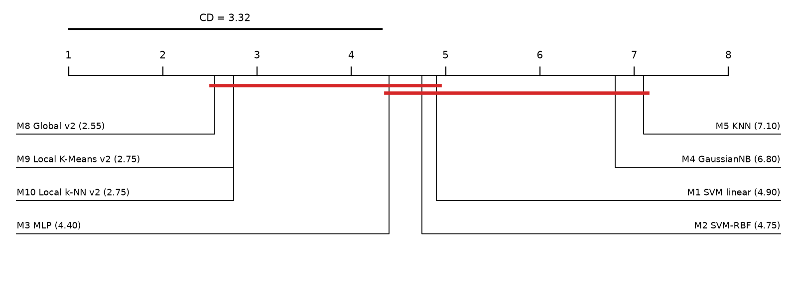

# Classificação híbrida por competência local

> Versão em texto do roteiro. A apresentação editável, no template do PPGEC e com o diagrama da arquitetura desenhado em formas nativas, é gerada em `slides/exports/apresentacao.pptx` (ver [slides/README.md](../slides/README.md)).

## 1. Pergunta

- **Ponderar os classificadores pela competência em cada região do espaço de atributos supera a
  ponderação global?**
- 10 bases UCI binárias, 5 classificadores individuais e 5 híbridos (2 na formulação da aula, 3 propostos).
- A hipótese é testada, não presumida.

---

## 2. Bases e protocolo

| Base | n × p | % classe minoritária |
|---|---|---|
| Sonar | 208 × 60 | 47 |
| Ionosphere | 351 × 34 | 36 |
| Banknote | 1372 × 4 | 44 |
| Blood | 748 × 4 | 24 |
| Climate | 540 × 18 | 9 |
| QSAR | 1055 × 41 | 34 |
| Raisin | 900 × 7 | 50 |
| Rice | 3810 × 7 | 43 |
| Spambase | 4601 × 57 | 39 |
| Retinopathy | 1151 × 19 | 47 |

- Validação cruzada aninhada: 3 repetições × 5 folds externos × 3 internos, com duplicatas na mesma partição.
- Tudo é ajustado só no treino: pré-processamento, competências, regiões e calibração.
- Métrica principal: ROC-AUC. Também se reportam acurácia balanceada, sensibilidade e especificidade.
- Testes com as bases como blocos: Friedman + Nemenyi; Wilcoxon com correção de Holm e teste do sinal.

---

## 3. Arquitetura

A figura vem do Lucidchart (guia em [DIAGRAMA_ARQUITETURA.md](DIAGRAMA_ARQUITETURA.md)). Etapas:

1. Pré-processamento.
2. Cinco classificadores base, com vieses indutivos diferentes: margem, kernel, rede neural, MAP, instâncias.
3. Calibração das probabilidades.
4. Região de competência, sem rótulos.
5. Pesos por competência.
6. Fusão ponderada e argmax.

---

## 4. Ponto de partida: a fórmula da aula colapsa

- Ponderação de performance (aula 09): `w_m = α_m / Σ α_r`, com `α` = acurácia fora da amostra.
- As acurácias ficam entre 0,6 e 1,0, então os pesos variam apenas 0,003–0,05 em torno de 0,20. **O híbrido
  global (M6) vira, na prática, a média simples.**
- A mesma fórmula por cluster do K-Means, com K = 3 (M7), muda a decisão de M6 em no máximo 0,4% das
  instâncias.
- Um modelo no nível da classe majoritária ainda recebe ~20% do peso. O Naive Bayes, com probabilidades
  extremas, chegou a decidir sozinho contra os outros quatro em 9% das instâncias de Retinopathy (execução
  exploratória).
- É o cenário do exemplo da aula 09: com competências parecidas, a fusão perde a especialização por região.

---

## 5. Mecanismo autoral

1. **Calibração** de cada modelo (Platt), ajustada nas predições fora da amostra.
2. **Competência acima da classe majoritária** da região (critério da aula 03), suavizada para regiões
   pequenas:

   `â = (acertos + λ·a_global) / (n_R + λ)`,
   `π̂_R = (positivos + λ·π_global) / (n_R + λ)`, `base_R = max(π̂_R, 1 − π̂_R)`,
   `w_m ∝ max(â_m − base_R, 0)`

   Quem não supera a classe majoritária suavizada recebe peso zero. Se nenhum modelo supera,
   usam-se os pesos globais de M8; se nenhum supera globalmente, pesos iguais.
3. **Região:**
   - M8: global;
   - M9: cluster do K-Means;
   - M10: k vizinhos da instância.

   K, k e λ são escolhidos por ROC-AUC nas dobras internas. **K = 1 equivale ao global**, então o
   local só atua quando os dados de treino mostram sinal.

Sem combinadores prontos (`VotingClassifier`/`StackingClassifier`): agrupamento, calibração, pesos e fusão
são código próprio.

---

## 6. Comparação entre bases

- **Friedman:** χ² = 37,46, p = 3,8·10⁻⁶. Ranking médio: M8 2,55; M9 2,75; M10 2,75; MLP 4,40; SVM-RBF 4,75;
  SVM linear 4,90; NB 6,80; KNN 7,10.
- **Nemenyi (CD = 3,32):** os três híbridos superam NB e KNN, mas não se distinguem das SVMs nem da MLP.
- **Wilcoxon:** M9 vence as SVMs e a MLP em 8 de 10 bases (p bruto entre 0,02 e 0,04), mas nenhuma diferença
  se mantém após a correção de Holm.

---

## 7. O que cada mudança fez

| Comparação | Δ ROC-AUC | Vitórias / derrotas / empates | p (Holm) |
|---|---|---|---|
| M8 × M6: calibração + competência corrigida × fórmula da aula | +0,0058 | 9 / 0 / 1 | **0,012** |
| M9 × M7: local v2 × local original | +0,0056 | 6 / 3 / 1 | 0,29 |
| M9 × M8: local (K-Means) × global | +0,0001 | 4 / 5 / 1 | 1,00 |
| M10 × M8: local (vizinhança) × global | −0,0003 | 3 / 6 / 1 | 0,35 |

M8 × M6 muda simultaneamente a calibração e a definição de competência; não permite atribuir o ganho
isoladamente a uma delas. Os p-valores de Holm pertencem a famílias distintas: M9 × M8 está na família
de controle; as outras três linhas, na família de ablação.

- **Onde o híbrido ganhou:** Retinopathy (de 0,798 para 0,822; melhor individual: 0,815) e Blood (de 0,729
  para 0,750, empatado com a MLP).
- **O local atua, mas não ajuda:** os pesos se deslocam até 28% e a decisão muda em até 4% das instâncias,
  sem ganho. A validação interna volta a K = 1 em Banknote e Spambase.

---

## 8. Conclusões e limitações

- Calibração e competência corrigida, em conjunto, superam a fórmula da aula com significância estatística.
- Os híbridos lideram o ranking e superam NB e KNN. Com 10 bases, não há ganho significativo sobre SVMs e MLP.
- **Não há evidência de que a ponderação local supere a global nestas bases.** Isso não demonstra
  equivalência. Desta vez, porém, é um resultado do experimento, e não um efeito do desenho do modelo.
- **Limitações:**
  - limiar de decisão de 0,5 na classe minoritária (sensibilidade de 0,12 em Blood, especificidade de 0,55 em
    Climate);
  - poder estatístico limitado com 10 bases;
  - hiperparâmetros dos modelos base fixos;
  - há avisos de convergência da MLP em QSAR e Retinopathy.
- **Reprodutibilidade:** decisões fixadas antes da execução, desvio registrado e validação independente dos
  artefatos ([PLANO.md](PLANO.md)).
