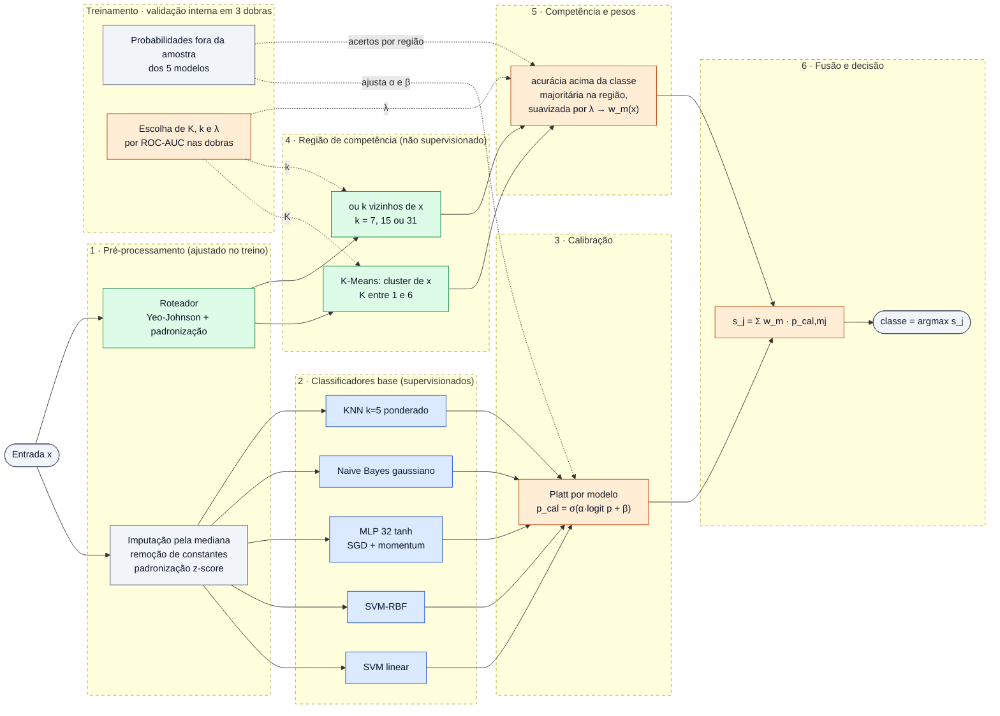

# Diagrama da arquitetura: guia para o Lucidchart

A figura mostra o sistema híbrido da versão 2 em uso (inferência), com uma faixa inferior indicando o que é
estimado no treinamento. Cada etapa fica delimitada por linha tracejada, como pede a especificação.

Há dois caminhos para montar a figura.

## Caminho A: importar o código Mermaid

No Lucidchart, use o recurso de diagrama a partir de código Mermaid (*diagram as code*) e cole o bloco
abaixo. Duas ressalvas:

- o resultado costuma vir como um bloco gerado, sem formas arrastáveis individualmente;
- cores e tracejados (`classDef`/`style`) podem não ser preservados.

Se precisar ajustar o layout ou o estilo, use o caminho B.



## Caminho B: desenhar à mão (controle total)

### Layout

Fluxo da esquerda para a direita, em duas faixas:

```text
 Faixa superior (inferência)
 ┌ 1 ┐   ┌──── 2 ────┐   ┌ 3 ┐               ┌ 6 ┐
 x ─▶│ P │─▶│ M1 … M5   │─▶│ C │──────────────▶│ F │─▶ classe
     │   │   └───────────┘   └───┘          ┌──▶│   │
     │RT │─────────▶┌ 4 ┐─────────▶┌ 5 ┐───┘   └───┘
     └───┘          │K/N│          │ W │
                    └───┘          └───┘
 Faixa inferior (treinamento)  ┌───────── T ─────────┐
                               │ O (OOF)     S (K,k,λ)│ ··▶ C, W, K/N (setas pontilhadas)
                               └─────────────────────┘
```

### Contêineres (retângulos com borda tracejada, sem preenchimento ou com cinza muito claro)

| Contêiner | Título |
|---|---|
| E1 | 1 · Pré-processamento (ajustado no treino) |
| E2 | 2 · Classificadores base (supervisionados) |
| E3 | 3 · Calibração |
| E4 | 4 · Região de competência (não supervisionado) |
| E5 | 5 · Competência e pesos |
| E6 | 6 · Fusão e decisão |
| T | Treinamento · validação interna em 3 dobras |

### Formas

As cores codificam o tipo de componente:

| Tipo | Preenchimento | Borda |
|---|---|---|
| Supervisionado | azul claro `#dbeafe` | `#1d4ed8` |
| Não supervisionado | verde claro `#dcfce7` | `#15803d` |
| Mecanismo autoral | laranja claro `#ffedd5` | `#c2410c` |
| Dados | cinza `#f1f5f9` | `#475569` |

| ID | Contêiner | Texto | Tipo |
|---|---|---|---|
| X | — | Entrada x | dados (elipse) |
| P | E1 | Imputação pela mediana · remoção de constantes · padronização z-score | dados |
| RT | E1 | Roteador: Yeo-Johnson + padronização | não supervisionado |
| M1–M5 | E2 | SVM linear · SVM-RBF · MLP 32 tanh, SGD + momentum · Naive Bayes gaussiano · KNN k=5 ponderado (cinco caixas empilhadas) | supervisionado |
| C | E3 | Platt por modelo: p_cal = σ(α·logit p + β) | autoral |
| K | E4 | K-Means: cluster de x (K entre 1 e 6) | não supervisionado |
| N | E4 | ou k vizinhos de x (k = 7, 15 ou 31) | não supervisionado |
| W | E5 | acurácia acima da classe majoritária na região, suavizada por λ → w_m(x) | autoral |
| F | E6 | s_j = Σ w_m · p_cal,mj | autoral |
| Y | E6 | classe = argmax s_j | dados (elipse) |
| O | T | Probabilidades fora da amostra dos 5 modelos | dados |
| S | T | Escolha de K, k e λ por ROC-AUC nas dobras | autoral |

### Setas

Contínuas (fluxo de inferência):

- X → P
- X → RT
- P → M1, M2, M3, M4, M5
- M1…M5 → C
- RT → K
- RT → N
- K → W
- N → W
- C → F
- W → F
- F → Y

Pontilhadas, com rótulo (o que vem do treinamento):

- O → C: "ajusta α e β"
- O → W: "acertos por região"
- S → K: "K"
- S → N: "k"
- S → W: "λ"

### Legenda sugerida (canto inferior direito)

- Retângulo tracejado: etapa.
- Seta pontilhada: parâmetro estimado no treinamento.
- Cores conforme a tabela de tipos acima.
- M8 usa a região global, M9 o cluster do K-Means e M10 os k vizinhos. Com K = 1, M9 equivale a M8.

Depois de pronto, exporte a figura como PNG em `docs/diagramas/arquitetura_v2.png`. A apresentação já aponta
para esse caminho.
