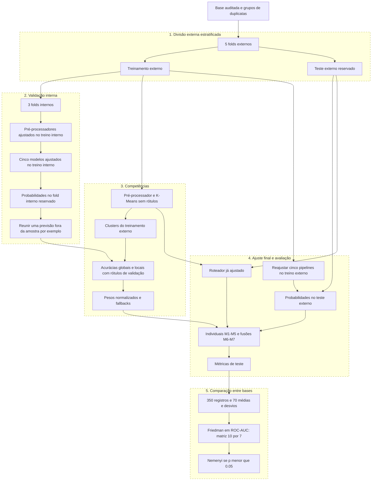
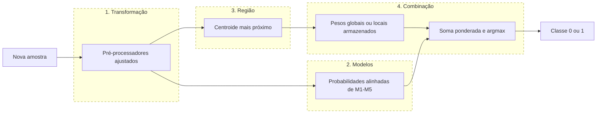

# Mecanismo autoral e arquitetura

Para cada fold externo, os dados de teste ficam isolados. Três folds internos produzem probabilidades fora da amostra de treinamento para os cinco classificadores. Cada pipeline ajusta mediana, remoção de constantes e StandardScaler somente no respectivo treinamento. Colunas totalmente ausentes no treino são imputadas com zero e removidas como constantes. Não há seleção supervisionada de atributos, balanceamento ou otimização.

Seja \(p_{imj}\) a probabilidade da classe \(j\in\{0,1\}\), estimada para o exemplo \(i\) pelo modelo \(m\), sem treinar nesse exemplo. As colunas são alinhadas a `[0,1]`; \(\hat y_{im}=\arg\max_j p_{imj}\). Empates retornam 0 em todos os modelos e híbridos. Isso também vale para SVM, sem usar seu método `predict`.

O roteador ajusta seu próprio pré-processamento e K-Means no treinamento externo inteiro, sem rótulos, com K=3, n_init=20 e semente 42. Esse passo é o protocolo especificado: o roteador vê atributos do treinamento externo, incluindo os exemplos internos de validação, mas nunca o teste externo. Os modelos que produzem as probabilidades internas não veem tais exemplos no ajuste.

\[
c(i)=\arg\min_c\|z_i-\mu_c\|_2,\qquad
a_m=\frac1n\sum_i\mathbf1[\hat y_{im}=y_i],\qquad
a_{mc}=\frac{\sum_{i:c(i)=c}\mathbf1[\hat y_{im}=y_i]}{n_c}.
\]

\[
w_m=\frac{a_m}{\sum_r a_r},\qquad
w_{mc}=\frac{a_{mc}}{\sum_r a_{rc}},\qquad
s_j(x)=\sum_m w_m(x)p_{mj}(x).
\]

M6 usa \(w_m(x)=w_m\); M7 usa \(w_m(x)=w_{m,c(x)}\). Cluster sem validação ou soma local zero usa pesos globais; soma global zero usa 1/5. Sem suavização, expoentes ou outros ajustes. As probabilidades são estimativas, sem garantia de calibração perfeita. Os modelos finais são ajustados novamente em todo o treinamento externo; nenhum peso é recalculado no teste.

Within é \(W=\sum_c\sum_{i:c(i)=c}\|z_i-\mu_c\|^2\); between é \(B=\sum_c n_c\|\mu_c-\bar z\|^2\). Também se registra W por amostra em cada cluster. São medidas descritivas, sem selecionar K. PCA é ajustada somente ao treino externo e usada exclusivamente nas figuras; os modelos e o roteador mantêm todas as dimensões não constantes. Números de clusters são arbitrários entre folds; não representam classes estáveis.

Na inferência, pesos e transformações são fixos:

A ROC-AUC usa o score contínuo positivo. Precisão, sensibilidade ou especificidade com denominador zero são NaN, acompanhadas da causa; agregações registram contagens válidas. Desvios são amostrais, ddof=1. Friedman utiliza bases como blocos, nunca os folds. Nemenyi utiliza ranks médios nos empates e \(q_{0,05}=Q_{0,95}(7,\infty)/\sqrt2\), com \(CD=q\sqrt{7\cdot8/(6\cdot10)}\). Referência de implementação: [scikit-posthocs](https://scikit-posthocs.readthedocs.io/en/latest/generated/scikit_posthocs.posthoc_nemenyi_friedman.html).
