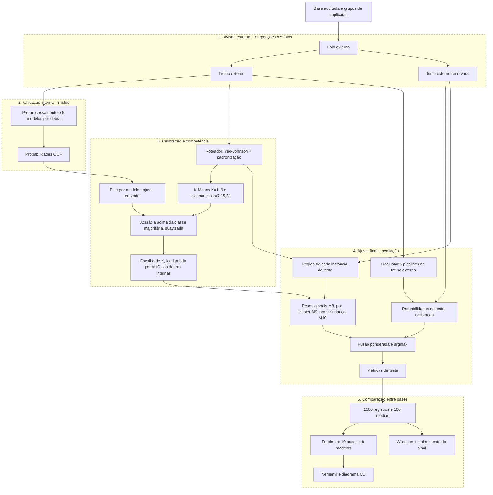
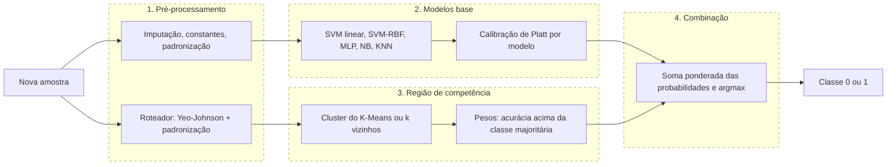

# Mecanismo autoral e arquitetura

Especificação completa em [AGENTS.md](AGENTS.md); decisões fixadas antes da execução em [PLANO.md](PLANO.md).

## Treinamento em cada fold externo

Os dados de teste ficam isolados. Três folds internos produzem probabilidades fora da amostra (OOF) dos cinco
classificadores. Cada pipeline ajusta mediana, remoção de constantes e StandardScaler somente no respectivo
treinamento. Não há seleção supervisionada de atributos, balanceamento nem otimização de hiperparâmetros dos
modelos base.

Seja \(p_{mj}(x)\) a probabilidade da classe \(j \in \{0,1\}\) dada pelo modelo \(m\). Toda predição é
\(\arg\max_j\), com empate resolvido para a classe 0.

### Formulação original (M6, M7)

\[
a_m=\frac1n\sum_i\mathbf1[\hat y_{im}=y_i],\qquad
a_{mc}=\frac{1}{n_c}\sum_{i:c(i)=c}\mathbf1[\hat y_{im}=y_i],\qquad
w_m=\frac{a_m}{\sum_r a_r},\qquad w_{mc}=\frac{a_{mc}}{\sum_r a_{rc}}.
\]

\(c(x)\) é o cluster do K-Means (K = 3) sobre os atributos padronizados. Como as acurácias ficam entre 0,6 e
1,0, os pesos ficam perto de 1/5, e M6 e M7 quase coincidem com a média simples (ver
[ESTUDO_MELHORIAS.md](ESTUDO_MELHORIAS.md)).

### Formulação revisada (M8, M9, M10)

1. **Calibração.** \(\tilde p_{m1}(x)=\sigma(\alpha_m\,\mathrm{logit}\,p_{m1}(x)+\beta_m)\), com os
   parâmetros ajustados nas OOF por máxima verossimilhança e alvos suavizados de Platt. Ajuste cruzado: cada
   dobra interna é calibrada com as outras duas. Os parâmetros finais (todas as OOF) calibram o teste.
2. **Região.** Fica no espaço do roteador (Yeo-Johnson + padronização, ajustado no treino externo sem rótulos):
   - M8: todo o treino externo;
   - M9: cluster do K-Means;
   - M10: os k vizinhos mais próximos.
3. **Competência acima da classe majoritária, suavizada.** Para a região \(R\) com \(n_R\) exemplos:

\[
\hat a_{mR}=\frac{\text{acertos}_{mR}+\lambda a_m}{n_R+\lambda},\qquad
\hat\pi_R=\frac{\text{positivos}_R+\lambda\pi}{n_R+\lambda},\qquad
b_R=\max(\hat\pi_R,1-\hat\pi_R),
\]
\[
w_{mR}=\frac{\max(\hat a_{mR}-b_R,0)}{\sum_r\max(\hat a_{rR}-b_R,0)}.
\]

   Sem modelo acima da base na região, usam-se os pesos globais de M8; sem modelo acima da base global, 1/5.
   Com \(\lambda\to\infty\) ou uma única região, os pesos locais tendem aos globais.
4. **Escolha de K (M9), k (M10) e λ.** Para cada candidato, as competências de cada dobra interna são estimadas
   só com as outras dobras. As OOF são fundidas e avaliadas por ROC-AUC, e vence o maior valor. Empates ficam
   com a configuração mais suave (K menor, k maior, λ maior); K = 1 é a ponderação global.
5. **Fusão.** \(s_j(x)=\sum_m w_m(x)\,\tilde p_{mj}(x)\), classe \(\arg\max_j s_j(x)\).

Os cinco modelos são reajustados no treino externo inteiro. Nenhum peso, calibração ou região é recalculado no
teste.

### Limites de interpretação e melhorias futuras

M8 × M6 altera duas coisas ao mesmo tempo: calibração e competência. A diferença observada é do conjunto;
não identifica a contribuição individual de cada mudança. Separá-las exigiria novos contrastes e um novo
plano experimental, não uma alteração retrospectiva desta execução.

O isolamento de duplicatas é aplicado aos folds externos e aos três folds internos de avaliação.
Dentro de cada ajuste das SVMs, porém, `CalibratedClassifierCV(cv=5)` usa sua própria divisão estratificada,
sem os grupos de duplicatas; o pré-processador também já foi ajustado no treino desse pipeline. Assim,
essas cinco subdivisões de calibração não têm o mesmo isolamento dos folds de avaliação. Isso não coloca
o teste externo no ajuste, mas é uma limitação da calibração interna. Usar grupos e pré-processamento
por subdivisão seria uma revisão de protocolo e exigiria refazer os resultados.

A escolha de K, k e λ reutiliza as OOF e a calibração cruzada do treino externo. As predições usadas para
estimar competências em outras dobras podem ter calibradores ajustados com rótulos da dobra que está sendo
pontuada. Portanto, a AUC interna é um critério de escolha, não uma estimativa independente de desempenho.
A avaliação final permanece nos testes externos reservados. Um nível adicional de ajuste cruzado seria
necessário para isolar também essa dependência interna e mudaria o protocolo atual.

## Inferência (pesos, calibração e regiões fixos)

## Medidas descritivas

- **Within e between.** Within é \(W=\sum_c\sum_{i\in c}\|z_i-\mu_c\|^2\) e between é
  \(B=\sum_c n_c\|\mu_c-\bar z\|^2\). Para cada K, registra-se \(B/(B+W)\), que descreve os grupos sem
  selecionar K.
- **Diversidade (OOF).** Acurácia do oráculo, discordância entre pares e Q de Yule médio.
- **Outras métricas.** A ROC-AUC usa o score contínuo positivo. Métricas com denominador zero são NaN,
  acompanhadas da causa. Desvios são amostrais (ddof=1) sobre 15 folds que se sobrepõem entre repetições.
- **Testes.** Friedman com bases como blocos; Nemenyi com \(q_{0,05}=Q_{0,95}(8,\infty)/\sqrt2\) e
  \(CD=q\sqrt{8\cdot9/(6\cdot10)}\); Wilcoxon pareado (diferenças nulas divididas) com Holm, e teste do sinal.
